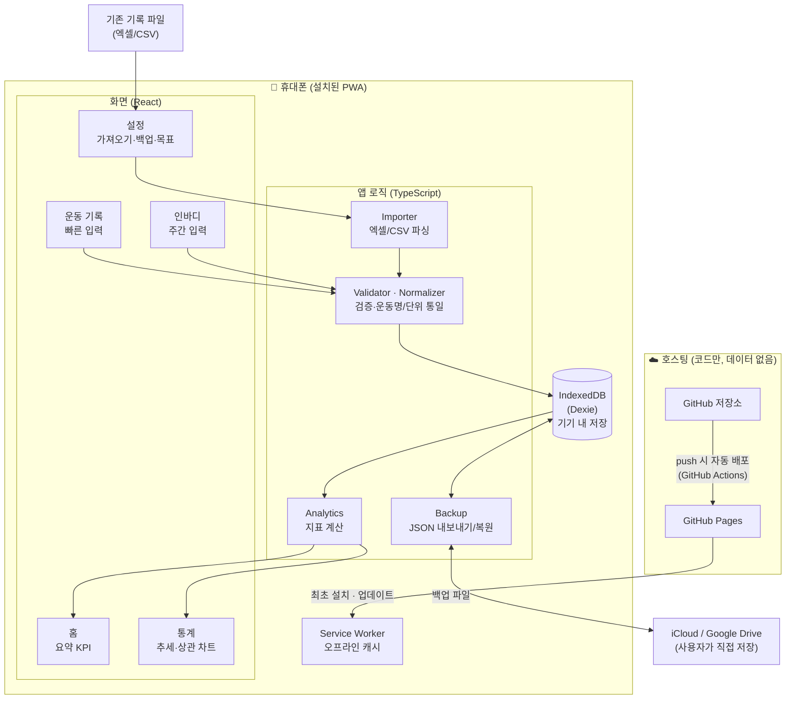
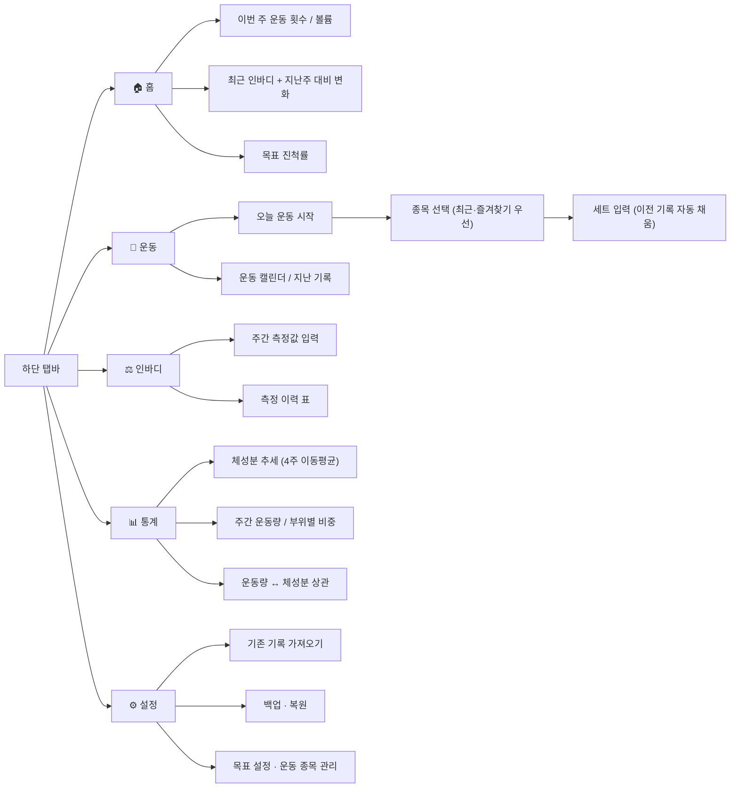
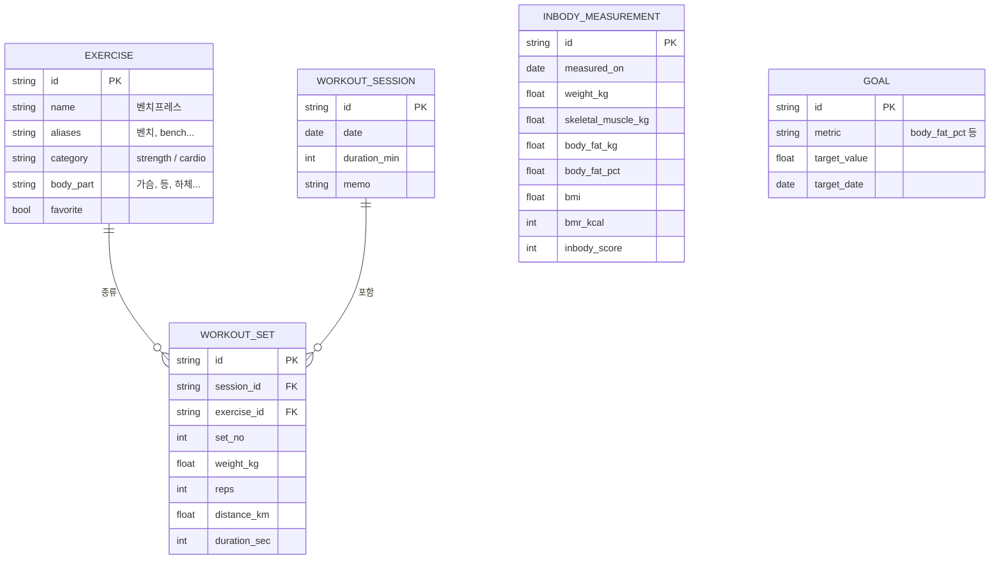
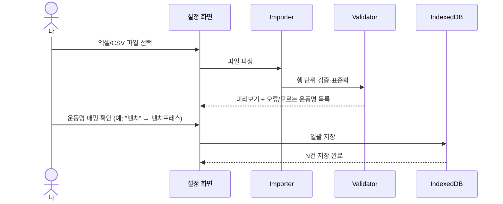
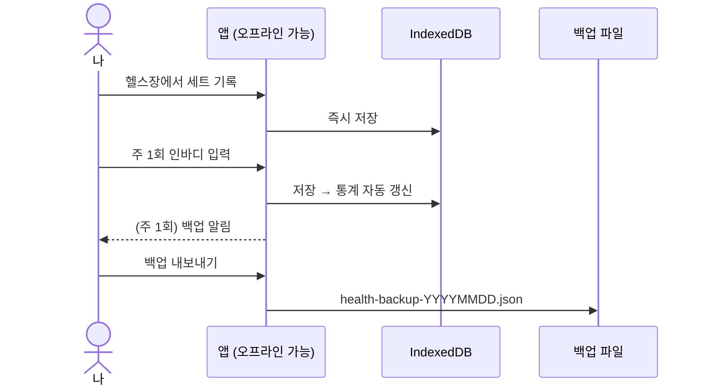

# 건강관리 현황 시스템 — 시스템 구조 (v0.2, 모바일 앱)

2024년 10월부터의 **운동 기록**과 **주 1회 인바디 기록**을 휴대폰 앱 하나로 기록·조회·분석하는 개인용 시스템입니다.

> v0.1(PC용 Python + Streamlit) → v0.2: **휴대폰에 설치해서 상시 사용하는 앱**으로 방향 변경

---

## 1. 목표

| 구분 | 내용 |
|---|---|
| 상시 사용 | 휴대폰 홈 화면에 설치, 헬스장에서 **인터넷 없이도** 바로 기록 |
| 기록 통합 | 2024.10~ 기존 기록(엑셀/CSV)을 앱으로 한 번에 가져오기 |
| 현황 파악 | 체중·골격근량·체지방률 추세, 주간/월간 운동량을 한눈에 보기 |
| 인사이트 | 운동량 ↔ 체성분 변화의 관계, 목표 대비 진척도 확인 |
| 데이터 보호 | 건강 데이터는 **내 휴대폰에만 저장**, 백업 파일로 보관 |

---

## 2. 앱 형태: PWA (설치형 웹앱)

| 방식 | 장점 | 단점 | 판단 |
|---|---|---|---|
| **PWA** | iPhone·Android 모두 홈 화면 설치, 앱스토어 심사·비용 없음, 오프라인 동작, 푸시만 하면 자동 업데이트 | 헬스 앱(삼성헬스/애플건강) 직접 연동 불가 | ✅ **채택** |
| Flutter / React Native | 네이티브 기능(헬스 앱 연동, 위젯) | iPhone 설치에 개발자 계정(연 $99) 필요, 빌드·배포 번거로움 | 추후 필요 시 전환 |

PWA로 시작하고, 나중에 헬스 앱 자동 연동이 꼭 필요해지면 **Capacitor로 감싸서 네이티브 앱으로 전환**할 수 있습니다. 화면·로직 코드는 그대로 재사용됩니다.

---

## 3. 전체 구조



**핵심 원칙**
- 서버에는 **앱 코드만** 올라가고, 건강 데이터는 **휴대폰 안(IndexedDB)** 에만 저장됩니다.
- Service Worker가 앱 파일을 캐시하므로, 한 번 설치하면 **비행기 모드에서도 동작**합니다.
- 기기 변경·분실에 대비해 **백업 파일(JSON)** 을 내보내 클라우드 드라이브에 보관합니다.

---

## 4. 화면 구성



**헬스장 사용성**: 세트 입력 시 지난번 같은 종목의 중량·횟수를 자동으로 채우고, 큰 버튼과 +/- 조절로 한 손 입력이 가능하게 합니다.

---

## 5. 데이터 모델 (IndexedDB)



- ID는 UUID를 사용해, 나중에 여러 기기 동기화를 붙이더라도 충돌이 없도록 합니다.
- 모든 레코드에 `updated_at`을 두어 백업 복원 시 최신 값 기준으로 병합합니다.

---

## 6. 주요 흐름

### 6-1. 기존 기록 최초 가져오기 (1회)



### 6-2. 일상 사용



---

## 7. 기술 스택

| 영역 | 선택 | 이유 |
|---|---|---|
| 언어 | TypeScript | 타입으로 데이터 형식 오류 방지 |
| UI | React + Vite | 빠른 개발, 가벼운 번들 |
| 스타일 | Tailwind CSS | 모바일 화면 빠르게 구성 |
| PWA | vite-plugin-pwa (Workbox) | 설치·오프라인 캐시·업데이트 자동 처리 |
| 로컬 DB | Dexie.js (IndexedDB) | 브라우저 내 영구 저장, 쿼리 편리 |
| 차트 | Recharts | React 친화적, 모바일 터치 지원 |
| 파일 가져오기 | SheetJS(xlsx), PapaParse(csv) | 엑셀/CSV 파싱 |
| 테스트 | Vitest | 검증·분석 로직 단위 테스트 |
| 배포 | GitHub Actions → GitHub Pages | 무료, push하면 자동 배포 |

> GitHub Pages는 저장소가 **public**이어야 무료입니다. 저장소를 private으로 유지하려면 Cloudflare Pages(무료)로 배포합니다. 어느 쪽이든 저장소에는 개인 데이터가 없습니다.

---

## 8. 디렉터리 구조 (예정)

```
003.workout_mgmt/
├── README.md
├── docs/ARCHITECTURE.md
├── public/                     # 앱 아이콘, manifest
├── src/
│   ├── pages/                  # Home, Workout, InBody, Stats, Settings
│   ├── components/             # 차트, 입력 폼, 탭바
│   ├── db/                     # Dexie 스키마, 저장소 함수
│   ├── import/                 # 엑셀/CSV 파서, 검증, 운동명 사전
│   ├── analytics/              # 운동/체성분/상관/목표 지표
│   └── backup/                 # JSON 내보내기·복원
├── tests/
├── samples/                    # 가져오기 형식 예시(가짜 데이터)
└── .github/workflows/deploy.yml
```

---

## 9. 데이터 안전성

| 위험 | 대응 |
|---|---|
| 기기 분실·교체 | 주 1회 백업 알림 → JSON을 iCloud/Google Drive에 저장, 새 기기에서 복원 |
| 브라우저 저장공간 정리 | `navigator.storage.persist()`로 영구 저장 요청, 홈 화면 설치 상태로 사용 |
| 앱 업데이트 중 데이터 손실 | DB 스키마 버전 관리(Dexie migration), 업데이트 전 자동 스냅샷 |
| 개인정보 노출 | 서버 전송 없음, 저장소에는 가짜 샘플 데이터만 |

---

## 10. 개발 단계

| 단계 | 내용 | 결과물 |
|---|---|---|
| 1 | 프로젝트 셋업, PWA 설치·오프라인 확인, 자동 배포 | 휴대폰에 설치되는 빈 앱 |
| 2 | DB 스키마 + 인바디 입력/이력 | 주간 인바디 기록 시작 가능 |
| 3 | 운동 기록 (세션·세트 빠른 입력) | 헬스장에서 기록 시작 가능 |
| 4 | 기존 기록 가져오기 (2024.10~) | 과거 데이터 이관 완료 |
| 5 | 홈 요약 + 통계 차트 | 현황 대시보드 |
| 6 | 목표 추적, 백업·복원, 상관 분석 | 상시 운영 완성 |

---

## 11. 확인이 필요한 사항

1. 휴대폰 기종: iPhone인가요, Android인가요? (둘 다 지원하지만 테스트 우선순위 결정)
2. 기존 운동·인바디 기록 형태 (엑셀, 앱 내보내기, 결과지 사진 등)
3. 운동 구성: 근력 위주 / 유산소 병행
4. 저장소 공개 여부: public(GitHub Pages) / private(Cloudflare Pages)
