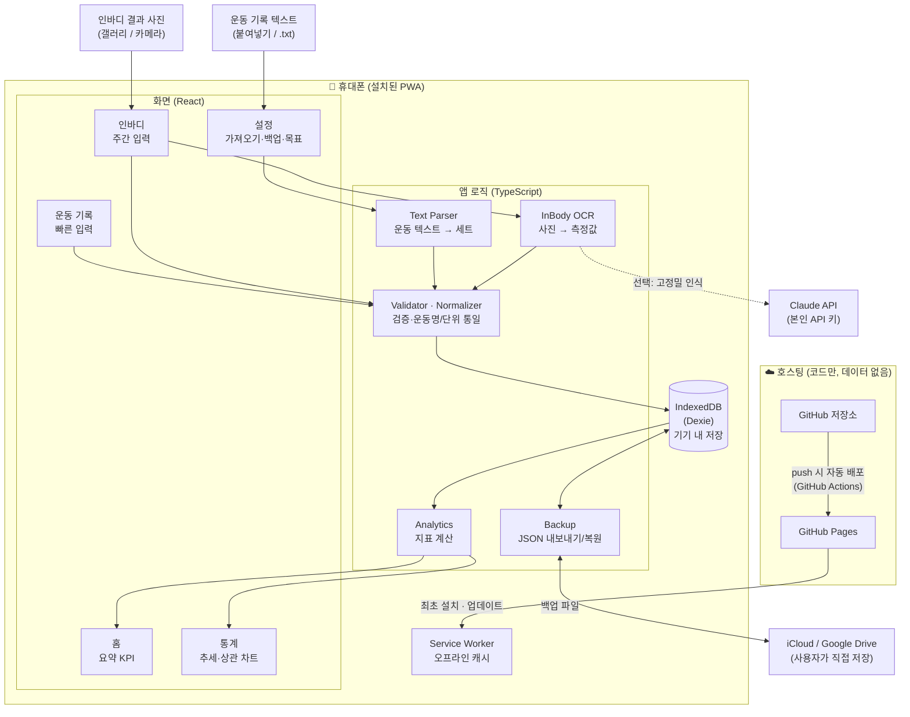
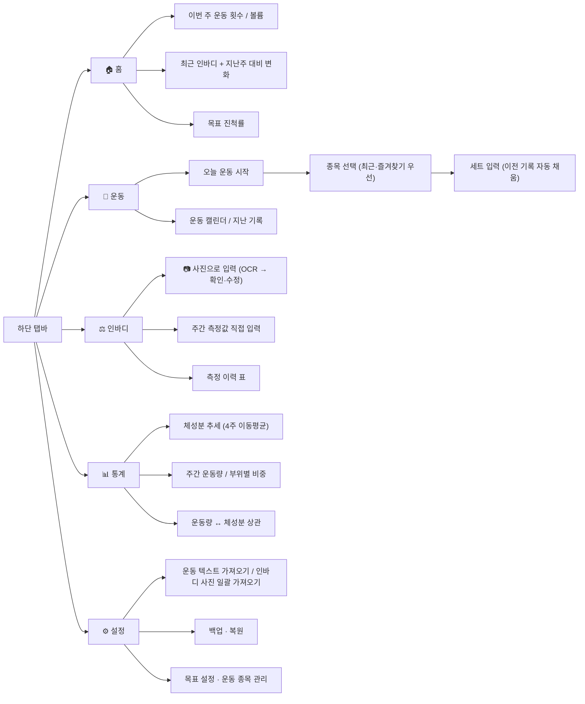
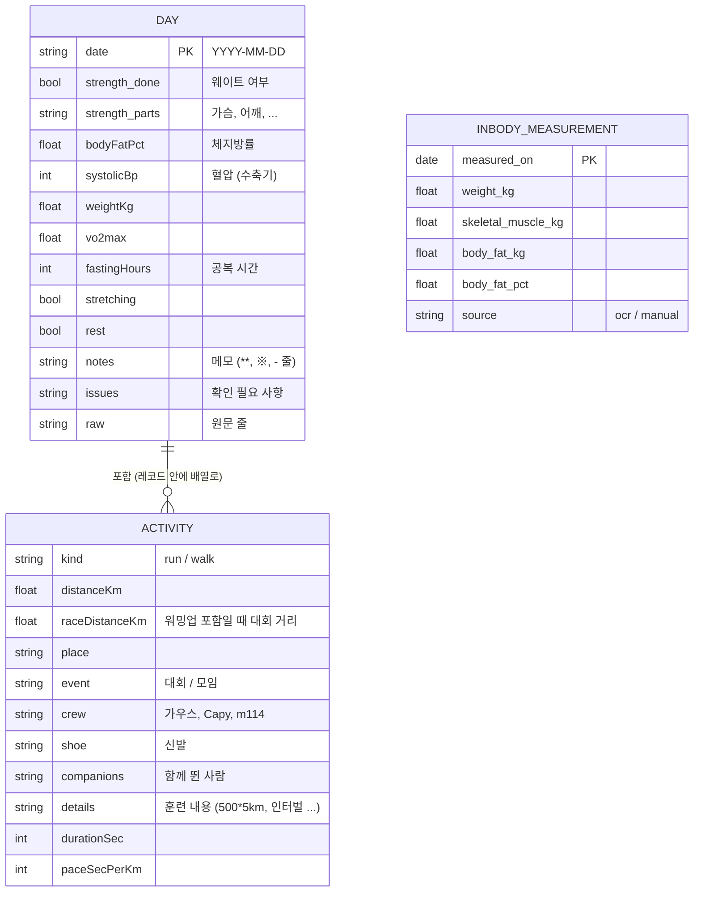
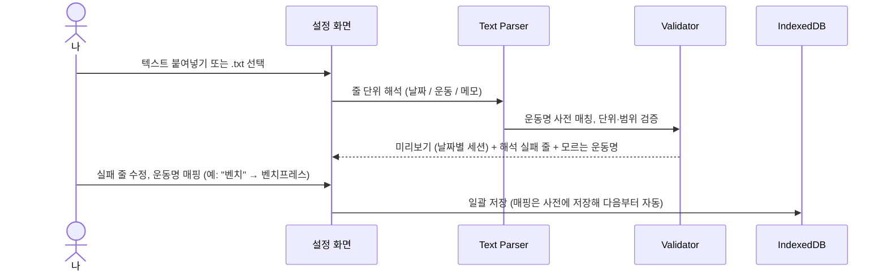
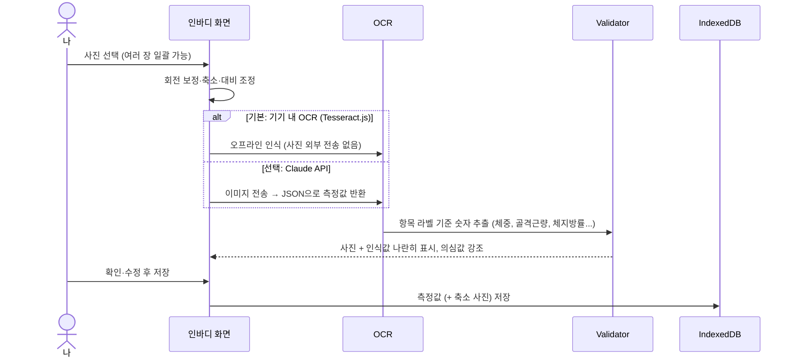
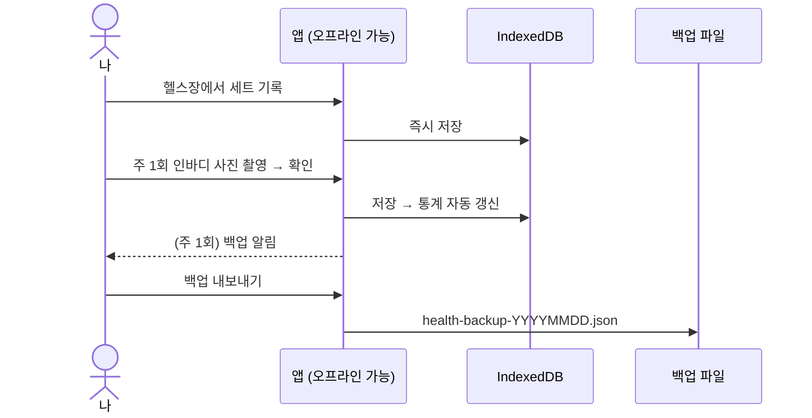

# 건강관리 현황 시스템 — 시스템 구조 (v0.4, Android PWA)

2024년 10월부터의 **운동 기록**과 **주 1회 인바디 기록**을 휴대폰 앱 하나로 기록·조회·분석하는 개인용 시스템입니다.

> v0.1(PC용 Python + Streamlit) → v0.2: **휴대폰에 설치해서 상시 사용하는 앱**으로 방향 변경
> v0.2 → v0.3: 확정 사항 반영 — **Android**, **public 저장소(GitHub Pages)**, 운동 기록은 **텍스트**, 인바디는 **사진**

### 확정 사항

| 항목 | 결정 | 구조에 미치는 영향 |
|---|---|---|
| 기기 | Android | Chrome에서 "앱 설치" → 일반 앱처럼 앱 서랍·홈 화면에 등록. Android는 PWA 지원이 가장 좋음 |
| 저장소 | public | GitHub Pages 무료 배포. 저장소에는 코드와 가짜 샘플만 |
| 운동 기록 | 텍스트 | **텍스트 파서** 필요 (붙여넣기/`.txt` 파일 → 구조화) |
| 인바디 | 사진 | **사진 → 숫자 인식(OCR)** 필요 + 확인·수정 화면 |

---

## 1. 목표

| 구분 | 내용 |
|---|---|
| 상시 사용 | 휴대폰 홈 화면에 설치, 헬스장에서 **인터넷 없이도** 바로 기록 |
| 기록 통합 | 2024.10~ 운동 텍스트 기록과 인바디 사진을 앱으로 한 번에 가져오기 |
| 현황 파악 | 체중·골격근량·체지방률 추세, 주간/월간 운동량을 한눈에 보기 |
| 인사이트 | 운동량 ↔ 체성분 변화의 관계, 목표 대비 진척도 확인 |
| 데이터 보호 | 건강 데이터는 **내 휴대폰에만 저장**, 백업 파일로 보관 |

---

## 2. 앱 형태: PWA (설치형 웹앱)

| 방식 | 장점 | 단점 | 판단 |
|---|---|---|---|
| **PWA** | Android Chrome에서 바로 설치, 앱스토어 심사·비용 없음, 오프라인 동작, 푸시만 하면 자동 업데이트 | 삼성헬스/Health Connect 직접 연동 불가 | ✅ **채택** |
| Flutter / React Native | 네이티브 기능(Health Connect 연동, 위젯) | 빌드·APK 관리 번거로움 | 추후 필요 시 전환 |

PWA로 시작하고, 나중에 헬스 앱 자동 연동이 꼭 필요해지면 **Capacitor로 감싸서 네이티브 앱으로 전환**할 수 있습니다. 화면·로직 코드는 그대로 재사용됩니다.

---

## 3. 전체 구조



**핵심 원칙**
- 서버에는 **앱 코드만** 올라가고, 건강 데이터는 **휴대폰 안(IndexedDB)** 에만 저장됩니다.
- Service Worker가 앱 파일을 캐시하므로, 한 번 설치하면 **비행기 모드에서도 동작**합니다.
- 기기 변경·분실에 대비해 **백업 파일(JSON)** 을 내보내 클라우드 드라이브에 보관합니다.

---

## 4. 화면 구성



**헬스장 사용성**: 세트 입력 시 지난번 같은 종목의 중량·횟수를 자동으로 채우고, 큰 버튼과 +/- 조절로 한 손 입력이 가능하게 합니다.

---

## 5. 데이터 모델 (IndexedDB)

실제 기록이 **러닝 중심의 하루 단위 메모**라서, 운동 세트 단위 표 대신 **하루 = 레코드 1개**로 저장합니다.
(700일 남짓이라 통계는 매번 전체를 읽어 계산해도 충분히 빠릅니다.)



**기록 표기 규칙** (텍스트 파서 기준)

| 표기 | 의미 |
|---|---|
| `500`, `436`, `417` | 1km당 페이스 5'00", 4'36", 4'17" |
| `10k/h`, `(워,11,12,13,쿨)` | 트레드밀 시속 (km/h) |
| `혈압 106` | 수축기 혈압 |
| `가우스 달벙` / `급벙` / `LSD` | 크루 정기 모임 / 번개 / 장거리 훈련 |
| `23키로(서울레이스, 1시간31분51초)` | 워밍업 포함 거리 — 페이스는 하프(21.0975km) 기준 |
| `레벨` = `레벨5` | 신발 별칭 (`src/import/dictionary.ts`) |

## 6. 주요 흐름

### 6-1. 운동 텍스트 가져오기 (1회 + 필요 시)

텍스트를 줄 단위로 읽어 **날짜 줄**과 **운동 줄**을 구분하고, 운동 줄에서 종목·중량·횟수·세트·시간·거리를 뽑아냅니다.

```text
예시 입력 (실제 형식은 샘플 확인 후 확정)      →  해석 결과
2024.10.03                                       →  세션: 2024-10-03
벤치 60kg 10x5                                   →  벤치프레스 60kg × 10회 × 5세트
스쿼트 80 8 8 6                                  →  스쿼트 80kg, 세트별 8/8/6회
런닝머신 30분 4.5km                              →  유산소 30분, 4.5km
```



- 해석 규칙은 **실제 기록 샘플**을 기준으로 만들고, 단위 테스트로 고정합니다.
- 규칙으로 해석 못 한 줄은 버리지 않고 "메모"로 보관해 나중에 수정할 수 있게 합니다.

### 6-2. 인바디 사진 → 측정값 (OCR)



| OCR 방식 | 정확도 | 비용 | 개인정보 | 용도 |
|---|---|---|---|---|
| **Tesseract.js** (기기 내) | 보통 — 사진 품질·구도에 좌우 | 무료 | 사진이 기기 밖으로 안 나감 | 기본값 |
| **Claude API** (비전) | 높음 — 양식·기울어진 사진도 잘 읽음 | 사진당 소액, 본인 API 키 필요 | 사진이 Anthropic API로 전송 | 과거 사진 일괄 처리, 기본 인식이 틀릴 때 |

- 어느 방식이든 **반드시 확인 화면**을 거쳐 저장합니다 (OCR 오류가 추세 차트를 망가뜨리지 않도록).
- 검증 규칙: 체지방량 + 제지방량 ≈ 체중, 체지방률 = 체지방량 ÷ 체중, 지난 측정 대비 급변(예: 체중 ±3kg) 경고.
- 측정 날짜는 결과지의 측정일 → 없으면 사진 촬영일(EXIF) → 없으면 직접 입력 순으로 정합니다.
- API 키는 휴대폰에만 저장하고 저장소·서버에는 두지 않습니다.

### 6-3. 일상 사용



---

## 7. 기술 스택

| 영역 | 선택 | 이유 |
|---|---|---|
| 언어 | TypeScript | 타입으로 데이터 형식 오류 방지 |
| UI | React + Vite | 빠른 개발, 가벼운 번들 |
| 스타일 | Tailwind CSS | 모바일 화면 빠르게 구성 |
| PWA | vite-plugin-pwa (Workbox) | 설치·오프라인 캐시·업데이트 자동 처리 |
| 로컬 DB | Dexie.js (IndexedDB) | 브라우저 내 영구 저장, 쿼리 편리 |
| 차트 | Recharts | React 친화적, 모바일 터치 지원 |
| 텍스트 파서 | 자체 구현 (정규식 + 운동명 사전) | 개인 기록 형식에 맞춤 |
| OCR (기본) | Tesseract.js (한국어 + 숫자) | 기기 내·오프라인·무료 |
| OCR (선택) | Claude API 비전 | 높은 인식 정확도 |
| 테스트 | Vitest | 검증·분석 로직 단위 테스트 |
| 배포 | GitHub Actions → GitHub Pages | 무료, push하면 자동 배포 |

> 저장소는 public → GitHub Pages로 배포합니다. 저장소에는 개인 데이터(운동 텍스트, 인바디 사진)를 **절대 커밋하지 않습니다**.

---

## 8. 디렉터리 구조 (예정)

```
003.workout_mgmt/
├── README.md
├── docs/ARCHITECTURE.md
├── public/                     # 앱 아이콘, manifest
├── src/
│   ├── pages/                  # Home, Workout, InBody, Stats, Settings
│   ├── components/             # 차트, 입력 폼, 탭바
│   ├── db/                     # Dexie 스키마, 저장소 함수
│   ├── import/                 # 운동 텍스트 파서, 검증, 운동명 사전
│   ├── ocr/                    # 인바디 사진 전처리, Tesseract/Claude 인식
│   ├── analytics/              # 운동/체성분/상관/목표 지표
│   └── backup/                 # JSON 내보내기·복원
├── tests/
├── samples/                    # 텍스트 형식 예시(가짜 데이터)
└── .github/workflows/deploy.yml
```

---

## 9. 데이터 안전성

| 위험 | 대응 |
|---|---|
| 기기 분실·교체 | 주 1회 백업 알림 → JSON을 iCloud/Google Drive에 저장, 새 기기에서 복원 |
| 브라우저 저장공간 정리 | `navigator.storage.persist()`로 영구 저장 요청, 홈 화면 설치 상태로 사용 |
| 앱 업데이트 중 데이터 손실 | DB 스키마 버전 관리(Dexie migration), 업데이트 전 자동 스냅샷 |
| 개인정보 노출 | 서버 전송 없음, 저장소에는 가짜 샘플 데이터만 |

---

## 10. 개발 단계

| 단계 | 내용 | 결과물 |
|---|---|---|
| 1 | 프로젝트 셋업, PWA 설치·오프라인 확인, 자동 배포 | 휴대폰에 설치되는 빈 앱 |
| 2 | 운동 텍스트 파서 + 확인·수정 화면 ✅ | 2024.10~ 기록 703일 이관 |
| 3 | 기기 저장(IndexedDB) + 통계 화면 ✅ | 월별 거리, 체지방률·혈압 추세, 신발, 대회, 크루 |
| 4 | 하루 기록 빠른 입력 (러닝·웨이트·체지방률) | 앱에서 바로 기록 |
| 5 | 인바디 결과지 사진 OCR + 확인 화면 | 체중·골격근량·체지방량 이관 |
| 6 | 홈 요약 | 현황 한눈에 |
| 7 | 목표 추적, 백업·복원, 상관 분석 | 상시 운영 완성 |

---

## 11. 확인이 필요한 사항

1. 과거 인바디 결과지 사진 일괄 처리에 Claude API(고정밀, 소액 비용) 사용 여부
