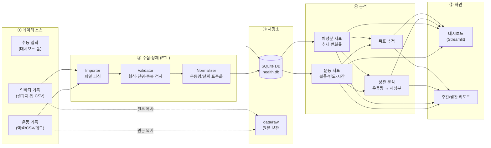
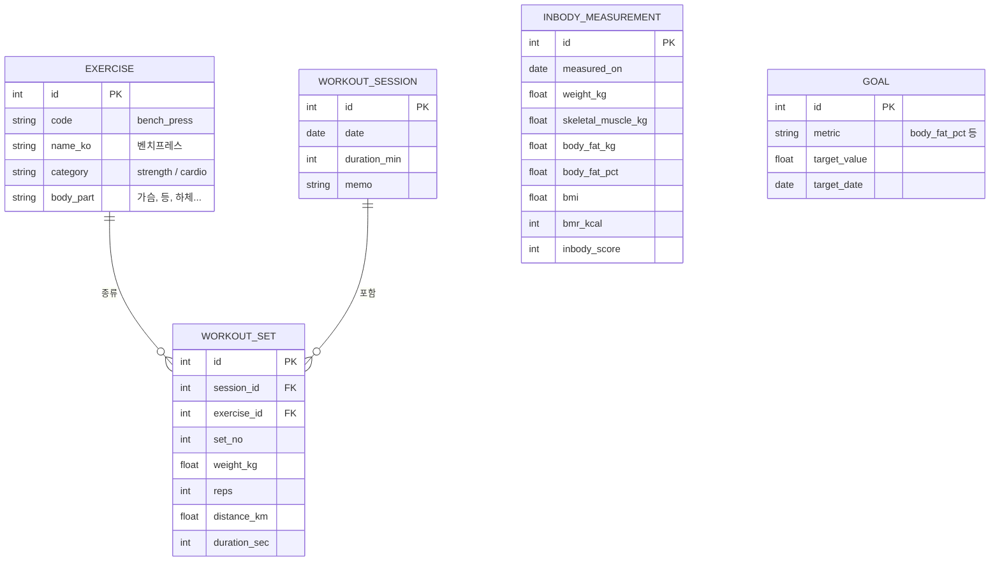
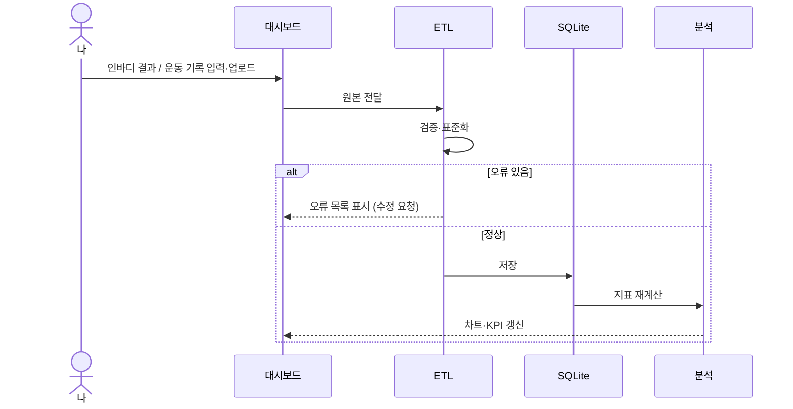

# 건강관리 현황 시스템 — 시스템 구조 (초안 v0.1)

2024년 10월부터의 **운동 기록**과 **주 1회 인바디 기록**을 한곳에 모아 정리하고,
추세·상관관계를 분석해 대시보드로 보여주는 개인용 시스템입니다.

---

## 1. 목표

| 구분 | 내용 |
|---|---|
| 기록 통합 | 흩어진 운동/인바디 기록(엑셀, 메모, 앱 내보내기 등)을 하나의 DB로 정리 |
| 현황 파악 | 체중·골격근량·체지방률 추세, 주간/월간 운동량 한눈에 보기 |
| 인사이트 | "운동량 ↔ 체성분 변화" 관계, 목표 대비 진척도 확인 |
| 지속 운영 | 새 기록을 쉽게 추가(파일 업로드 또는 입력 폼) |

---

## 2. 전체 구조



---

## 3. 계층별 설명

### ① 데이터 소스
- **운동 기록**: 날짜, 운동 종류, 세트/횟수/중량(근력) 또는 시간/거리(유산소)
- **인바디 기록**: 측정일, 체중, 골격근량, 체지방량, 체지방률, BMI, 기초대사량, (선택) 부위별 근육량
- **수동 입력**: 앞으로의 기록은 대시보드 폼에서 직접 입력

### ② 수집·정제 (ETL)
- `Importer`: 소스 형식별 파서 (CSV / XLSX / 텍스트 메모)
- `Validator`: 필수 값 누락, 이상치(예: 체중 ±5kg 급변), 중복 날짜 검출 → 리포트로 출력
- `Normalizer`: "벤치", "벤치프레스" → `bench_press`처럼 **운동명 사전**으로 통일, 단위(kg/lb, 분/초) 통일

### ③ 저장소
- **SQLite** 한 파일(`data/health.db`) — 개인용으로 충분하고 백업이 쉬움
- 원본 파일은 `data/raw/`에 그대로 보관 (재처리 가능하도록)
- ⚠️ 개인 건강 데이터이므로 `data/`는 `.gitignore` 처리, GitHub에는 **코드와 샘플 데이터만** 올림

### ④ 분석
| 모듈 | 산출 지표 |
|---|---|
| 운동 지표 | 주간 운동 횟수, 총 볼륨(세트×횟수×중량), 부위별 비중, 유산소 시간, 연속 운동일 |
| 체성분 지표 | 체중/골격근량/체지방률 추세, 4주 이동평균, 전월 대비 변화 |
| 상관 분석 | 주간 운동량 vs 다음 주 체성분 변화, 근력 볼륨 vs 골격근량 |
| 목표 추적 | 목표 체지방률·골격근량 대비 진척률, 예상 도달 시점 |

### ⑤ 화면
- **대시보드 (Streamlit)**: 요약 KPI 카드 → 체성분 추세 차트 → 운동 캘린더 히트맵 → 상관 차트
- **리포트**: 주간/월간 요약을 Markdown/HTML로 생성

---

## 4. 데이터 모델



---

## 5. 데이터 흐름 (기록 추가 시)



---

## 6. 기술 스택 (제안)

| 영역 | 선택 | 이유 |
|---|---|---|
| 언어 | Python 3.12 | 데이터 처리·시각화 생태계 |
| 데이터 처리 | pandas | CSV/엑셀 파싱, 집계 |
| 저장소 | SQLite | 설치 불필요, 단일 파일 |
| 대시보드 | Streamlit + Plotly | 코드 몇 줄로 인터랙티브 차트 |
| 테스트 | pytest | ETL 검증 로직 테스트 |

---

## 7. 디렉터리 구조 (예정)

```
003.workout_mgmt/
├── README.md
├── docs/
│   └── ARCHITECTURE.md        # 이 문서
├── data/                      # (gitignore) 개인 데이터
│   ├── raw/                   #   원본 파일
│   └── health.db              #   SQLite DB
├── samples/                   # 형식 예시용 가짜 데이터
├── src/workout_mgmt/
│   ├── etl/                   # importer, validator, normalizer
│   ├── db/                    # 스키마, 저장/조회
│   ├── analysis/              # 운동/체성분/상관/목표 지표
│   └── report/                # 주간·월간 리포트
├── app/
│   └── dashboard.py           # Streamlit 앱
└── tests/
```

---

## 8. 개발 단계

| 단계 | 내용 | 결과물 |
|---|---|---|
| 1 | 기존 기록 형식 확인, 스키마 확정 | 확정된 ERD, 샘플 데이터 |
| 2 | ETL + DB 구축, 2024.10~ 기록 적재 | `health.db`, 검증 리포트 |
| 3 | 분석 모듈 | 지표 계산 함수 + 테스트 |
| 4 | 대시보드 | Streamlit 앱 |
| 5 | 입력 폼·리포트·목표 추적 | 지속 운영 기능 |

---

## 9. 확인이 필요한 사항

1. 현재 운동 기록은 어떤 형태인가요? (엑셀, 운동 앱 내보내기, 메모장 등)
2. 인바디 기록은 어떤 항목까지 남겨두셨나요? (결과지 사진만 있다면 OCR 단계 추가 필요)
3. 운동 종류는 주로 근력 위주인가요, 유산소도 함께인가요?
4. 대시보드는 로컬 PC에서만 볼지, 휴대폰에서도 볼지 (배포 방식 결정)
